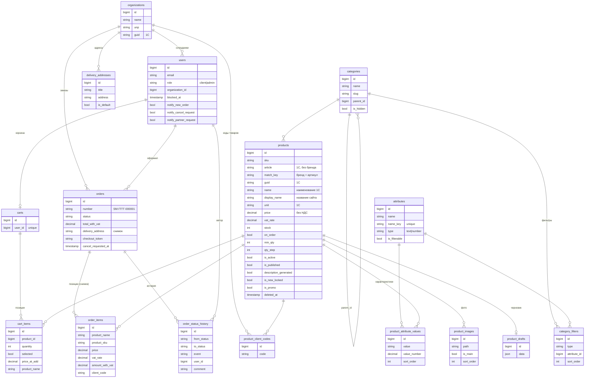

# Архитектура smesitel.by

Краткий обзор для нового разработчика. Как запускать и тестировать — `CLAUDE.md`, карта экранов — `docs/UI_INVENTORY.md`, модули по отдельности — `docs/MODULES.md`.

B2B-каталог сантехники: гость смотрит каталог без цен, клиент (сотрудник организации) видит цены и оформляет заказы на свою организацию, администратор ведёт товары, заказы и клиентов. Номера правил (BR-…, SRS §…) в комментариях кода ссылаются на ТЗ заказчика.

## 1. Стек и версии

| Слой | Технология | Версия (локально) |
|---|---|---|
| Язык | PHP | 8.2 (образ `php:8.2-fpm`) |
| Фреймворк | Laravel | 12 (`laravel/framework ^12.0`) |
| БД | MySQL | 8.0; в тестах — SQLite `:memory:` |
| Шаблоны | Blade, анонимные компоненты кита | — |
| JS | Alpine.js (+ `@alpinejs/focus`) | 3.17 |
| CSS | Tailwind CSS (+ `@tailwindcss/forms`) | 3.4 |
| Сборка | Vite + `laravel-vite-plugin` | 7.3 / 2.x |
| Node (сборка) | Node.js | 22 |
| Фото | `intervention/image` (GD, webp) | 3 |
| Иконки | `blade-ui-kit/blade-heroicons` | 2.7 |
| Тесты | PHPUnit + paratest | 11.5 / 7.8 |
| Стиль кода | Laravel Pint | 1.24 |

Auth на основе Breeze (`laravel/breeze` в dev). Самостоятельная регистрация отключена: учётные записи создаёт администратор.

## 2. Docker-сервисы

`docker-compose.yml` лежит в корне репозитория. Проект называется `smesitel_by`.

| Сервис | Образ | Порт на хосте | Назначение |
|---|---|---|---|
| `nginx` | `nginx:latest` | 8090 (`APP_PORT`) | Веб-сервер, конфиг `docker/nginx/default.conf` |
| `php` | `docker/php/Dockerfile` | — | PHP-FPM; здесь `artisan`, `composer` и тесты |
| `queue` | тот же образ | — | `queue:work --tries=3`: письма из очереди. После правок PHP — `docker-compose restart queue` |
| `mysql` | `mysql:8.0` | 3307 | БД, том `smesitel_by_dbdata`; пароли — только в `.env` |
| `mailpit` | `axllent/mailpit` | 8025 (веб), 1025 (SMTP) | Перехват почты локально |
| `node` | `node:22` | — | Только сборка: `npm run build` |

`vendor/` лежит в томе `smesitel_by_vendor`, а не в bind-mount, так быстрее. Стенд (`docker/staging/`) описан в `docs/STAGING.md`.

## 3. Структура каталогов

| Путь | Что там |
|---|---|
| `app/Http/Controllers` | Витрина и кабинет (`CatalogController`, `CartController`, `OrderController`…) |
| `app/Http/Controllers/Admin` | Админка (`Admin*Controller`), трейт `Concerns/UploadsProductImages` |
| `app/Http/Controllers/Auth` | Вход, сброс пароля, приглашение (Breeze) |
| `app/Http/Middleware` | `EnsureUserHasRole`, `EnsureUserIsNotBlocked` |
| `app/Services` | Бизнес-логика (корзина, оформление, статусы, НДС, фото, характеристики, приглашения) |
| `app/Services/Catalog` | Список категории с фильтрами, набор фильтров, ключевые характеристики |
| `app/Services/CatalogImport` | Импорт `catalog.db`: план → применение → отчёт |
| `app/Services/Vat` | `VatCalculator`; это единственное место расчёта НДС |
| `app/Models` | Eloquent-модели (схема — §8) |
| `app/Enums` | `OrderStatus`, `UserRole`, `CartState`, `CartProblemType`, `OrderHistoryEvent` |
| `app/Events`, `app/Listeners` | `OrderPlaced`, `CancelRequested` → `NotifyAdmins` |
| `app/Notifications` | Письма: администраторам о заказе и отмене, приглашение |
| `app/Observers` | `CatalogMenuObserver` сбрасывает кэш меню |
| `app/View/Composers` | Данные шапки: корзина и меню каталога |
| `app/Support` | `Money`, `Plural`, `CategoryName`, `helpers.php` (`money()`, `date_ru()`) |
| `app/Console/Commands` | `catalog:import-db`, `user:create`, `demo:clear`, `attributes:from-specifications` и др. |
| `config/shop.php` | Настройки магазина: фото, пороги наличия, режимы 1С; контакты — только начальные значения (на сайте — `Setting`) |
| `database/migrations` | Схема и миграции данных |
| `database/data/catalog/*.php` | Маппинги импорта (бренды, категории, характеристики, фильтры, чистка) |
| `database/seeders` | `DemoSeeder` (только `APP_ENV=staging`), демо-каталог, бенчмарк |
| `resources/views` | Страницы витрины и кабинета, `admin/`, `partials/`, `layouts/`, `components/` (кит) |
| `resources/js` | `app.js` и модули Alpine (§6) |
| `routes/*.php` | Маршруты по доменам, подключаются из `web.php` |
| `tests/Feature`, `tests/Unit` | Тесты; кит — `tests/Feature/Ui` |
| `docs/` | Документация; `docs/design/*.dc.html` — макеты (только референс) |

## 4. Слои и где бизнес-логика

```
Маршрут → [middleware] → Контроллер → Сервис → Модель → БД
                             ↓
                           Blade (кит)
```

| Слой | Ответственность | Примеры |
|---|---|---|
| Контроллер | Валидация запроса (`request()->validate`), выбор сервиса, ответ: view, редирект с flash или JSON для fetch | `CartController::add` отвечает JSON при `Accept: application/json` |
| Сервис | Правила и транзакции; бросает доменные исключения | `CheckoutService::place`, `OrderStatusService::change`, `CartValidator::validate` |
| Модель | Связи, скоупы, мелкие правила одной сущности | `Order::visibleTo()`, `Order::nextNumber()`, `Product::title()`, `DeliveryAddress::createFor()` |
| Enum | Справочники и переходы | `OrderStatus::allowedTransitions()`, `CartProblemType::code()` (ERR-013…018) |
| Исключение | Причины отказа с текстом для пользователя | `CheckoutException`, `InvalidStatusTransition`, `CancelRequestException`, `ImageUploadException` |

Простые CRUD (организации, адреса, характеристики) живут в контроллерах и моделях без сервиса. Всё, что касается денег, остатков и статусов, проходит через сервисы.

## 5. Роли, доступ и middleware

| Роль | Хранение | Что может |
|---|---|---|
| Гость | не хранится | Каталог, поиск, карточка; цен и кнопки «В корзину» нет, вместо неё «Войдите, чтобы заказать» |
| Клиент (`client`) | `users.role` | Цены, корзина, оформление на свою организацию, заказы организации, адреса доставки, профиль. Обязан быть привязан к организации (BR-111) |
| Администратор (`admin`) | `users.role` | Админка `/admin/*`; корзины и оформления у него нет (BR-121), в списках вместо «В корзину» кнопка перехода к товару в админке |

| Middleware | Где | Что делает |
|---|---|---|
| `auth` | корзина, заказы, профиль, админка | Гостя отправляет на вход |
| `role:admin` / `role:client` (`EnsureUserHasRole`) | `routes/admin.php`, адреса клиента | Нет нужной роли → 403 |
| `EnsureUserIsNotBlocked` | все web-запросы | Заблокированного выходит из сессии и отправляет на вход с сообщением «Учётная запись заблокирована» |
| `trustProxies('*')` | все запросы | Учитывает HTTPS за прокси на стенде |

Вход: `/login`, `?return=` возвращает на исходную страницу. `/account`: администратора ведёт на `/admin`, клиента — на `/orders`.

> ⚠ Отдельного маршрута `/admin` нет: логотип и меню админки ведут на `/admin/products`. Поэтому `/account` у администратора, скорее всего, отдаёт 404. Тест `ErrorPagesTest` проверяет только сам редирект.

## 6. Очередь, события, уведомления

| Событие | Кто вызывает | Слушатель | Результат |
|---|---|---|---|
| `OrderPlaced` | `CheckoutService::place` | `NotifyAdmins::handleOrderPlaced` | `NewOrderNotification` администраторам с `notify_new_order` |
| `CancelRequested` | `OrderStatusService::requestCancel` | `NotifyAdmins::handleCancelRequested` | `CancelRequestNotification` администраторам с `notify_cancel_request` |
| `PartnerRequested` | `PartnerController::store` | `NotifyAdmins::handlePartnerRequested` | `PartnerRequestNotification` администраторам с `notify_partner_request` |

- События реализуют `ShouldDispatchAfterCommit`: если транзакция откатилась, письма не будет.
- Письма идут через очередь (`QUEUE_CONNECTION=database`, таблица `jobs`), по задаче на получателя. При сбое повтор через 1 и 5 минут, потом задача попадает в `failed_jobs`.
- Ошибка постановки в очередь пишется в лог и не ломает оформление заказа.
- Слушатели регистрируются автообнаружением (`handle*` с типом события).
- `UserInvitation` (приглашение) отправляется сразу, без очереди и событий.
- Получатели — активные администраторы с включённой галочкой (`User::notifiedAdmins()`), настройка — в карточке администратора.
- Кэш (`CACHE_STORE=database`): дерево меню каталога (`CatalogMenu`, TTL `shop.catalog_menu_ttl`). Его сбрасывает `CatalogMenuObserver`; после массовых `update()` — вручную через `CatalogMenu::flush()`.

## 7. Фронтенд

| Что | Где | Правило |
|---|---|---|
| Layouts | `layouts/app` (витрина и кабинет), `layouts/admin`, `layouts/guest` (auth) | Flash выводит layout (`x-alert.flash`), не экран |
| UI-кит | `resources/views/components/` | Кнопки, поля, таблицы, бейджи, alert, confirm, цены — только компонентами кита. Параметры описаны в комментарии в начале файла |
| Крупные блоки | `resources/views/partials/` | Через `@include` |
| Шапка | `partials/header` + composers `HeaderComposer`, `CatalogMenuComposer` | Корзина и меню попадают во view автоматически |
| Форматы | `money()`, `<x-price>`, `date_ru()` | Сумма: `1 234,50 BYN`; дата: `ДД.ММ.ГГГГ` (в карточках с `ЧЧ:ММ`) |
| Стили | `tailwind.config.js` | Только токены (`bg-primary`, `rounded-card`, `status.*`, `tone.*`) |
| Сборка | `vite.config.js` | Вход: `resources/css/app.css`, `resources/js/app.js`. После правок классов — `npm run build` |

Компоненты кита:

| Группа | Компоненты |
|---|---|
| Формы | `x-input`, `x-select`, `x-textarea`, `x-checkbox`, `x-field`, `x-qty` |
| Действия | `x-button`, `x-confirm` (модальное подтверждение), `x-copy` (текст или поле с «копировать») |
| Данные | `x-table` (+ `.th`, `.td`), `x-badge`, `x-price`, `x-pagination`, `x-empty-state` |
| Сообщения | `x-alert`, `x-alert.flash` |
| Витрина | `x-breadcrumbs`, `x-stock`, `x-product-badge`, `x-product-row` (+ `.buy`), `x-cart-row`, `x-cart-quick-add`, `x-logo` |
| Наследие Breeze | `x-primary-button`, `x-text-input`, `x-modal` и др. — только auth и профиль, в новом коде не использовать |

JS-модули (`resources/js/app.js`). Страницы работают и без JS: формы и ссылки; JS добавляет обновление без перезагрузки.

| Модуль | Тип | Что делает |
|---|---|---|
| `search-suggest.js` | скрипт | Подсказки поиска в шапке (`/search/suggest`) |
| `cart-actions.js` | скрипт | «В корзину» и «+/−» из списков без перезагрузки |
| `cart-page.js` | скрипт | Корзина: количество, галочки, удаление, «Добавить по артикулу» |
| `qty-sync.js` | хелпер | Отправка количества без гонок (последнее значение побеждает) |
| `catalogFilters` | Alpine | Фильтры, сортировка и страница в URL, `history.pushState` |
| `megaMenu`, `mobileMenu` | Alpine | Мегаменю (desktop), мобильная шапка и меню (`/catalog/menu.json`) |
| `productGallery` | Alpine | Галерея карточки и lightbox |
| `skuSuggest` | Alpine | Подсказки артикула в корзине |
| `copyText` | Alpine | `x-copy`: clipboard API или запасной `execCommand` |
| `adminImages`, `imageQueue` | Alpine | Фото товара в админке: перетаскивание, очередь загрузки |
| `attributeRows` | Alpine | Строки характеристик в форме товара |

## 8. Схема БД

Основные таблицы. Служебные (`sessions`, `cache*`, `jobs`, `failed_jobs`, `job_batches`, `migrations`, `password_reset_tokens`) не показаны.



| Таблица | Заметки |
|---|---|
| `products` | Мягкое удаление (`deleted_at`). Цена без НДС, `vat_rate = null` — «Без НДС» (это не 0%). `is_active` — показан или скрыт админом; `is_published` — опубликован (новые из импорта приходят черновиками) |
| `orders` | Адрес и суммы — снимок на момент оформления. `total` устарел, на экранах — `total_*`. На `user_id` нет внешнего ключа |
| `order_items` | Снимок названия, артикула, цены и НДС; `product_id` может стать `null` |
| `order_sequences` | Счётчик номеров заказов по годам (`Order::nextNumber`) |
| `order_invoices` | Счёт на оплату, один на заказ: PDF в закрытом хранилище, `source` (`manual` / `erp`), `external_id` (номер в 1С), `uploaded_by` |
| `product_documents` | Документы товара: PDF на диске фото (публичная ссылка), `type` (`ProductDocumentType`), `title`, `size`, `sort_order` |
| `user_invitation_tokens` | Брокер приглашений: токен хешем, рядом `token_encrypted` (APP_KEY) для показа ссылки |
| `categories.image` | Картинка категории (webp) — плитки подкатегорий; в дереве меню (`CatalogMenu`) — поле `image` |
| `banners` | Слайдер главной: `image_desktop`, `image_mobile`, `url`, `sort_order`, `is_active` |
| `pages` | Информационные страницы: `slug`, `body` (HTML из Trix, при выводе очищается), SEO, `is_published`. Три страницы меню создаёт миграция с `[ЗАПОЛНИТЬ]` |
| `settings` | Ключ — значение: контакты (`contact_*`, телефоны — JSON), реквизиты продавца (`seller_*`) и тексты подвала (`Setting::FIELDS`), кэш `settings.all` |
| `partner_requests` | Заявки «Стать партнёром»: реквизиты, контакт, `consent_at`, `status`, `ip` |

## 9. Владение данными: 1С и сайт

Обмена с 1С пока нет. Код заранее разделяет поля, чтобы его можно было включить флагами `config/shop.php`.

| Данные | Владелец | Как в коде |
|---|---|---|
| Название, артикул, бренд, цена, НДС, остаток, «под заказ», кратность (`min_qty`, `qty_step`, `default_qty`) | **1С** (пока вводятся в админке) | `AdminProductController::ERP_FIELDS`. При `SHOP_CATALOG_MANUAL_PRODUCTS=false` поля только для чтения, создание товара — 403 |
| `products.guid`, `organizations.guid` | **1С** | Не в `$fillable`, в админке только чтение, пока не заполняются |
| Поля номенклатуры 1С: `article` (артикул без бренда), `unit`, `barcode`, `group_1c`, отметки обмена `synced_at` / `price_synced_at` / `stock_synced_at` | **1С** | Не в `$fillable`. `article` пока заполняет `catalog:fill-articles` из `catalog.db`; `match_key` (`Product::matchKey`: бренд + артикул без регистра, пробелов и дефисов) — ключ первичного сопоставления, пересчитывается при сохранении товара. `name` — наименование 1С, название сайта — `display_name` (`docs/1C_EXCHANGE_SPEC.md`) |
| Статусы заказа после «Передан в 1С» | **1С** (пока вручную) | При `SHOP_ORDERS_MANUAL_STATUS=false` ручная смена статусов отключена |
| Категория, адрес страницы (slug), «ХИТ», «НОВИНКА», «Акция» | **Сайт** | `DIRECT_SITE_FIELDS`, применяются сразу (SRS §11.3) |
| Отображаемое название, описание, характеристики (текст), комплектация | **Сайт** | `DRAFT_FIELDS`: через черновик (`product_drafts`) и «Опубликовать» |
| Характеристики, фото, видимость | **Сайт** | Справочник `attributes`, `ProductImageService`, `toggle-visibility` |
| Структура каталога, тексты, характеристики из `catalog.db` | **Сайт** (импорт) | `catalog:import-db`: цены и остатки не трогает; «Новинку», снятую в админке (`is_new_locked`), не возвращает; сгенерированные описания не показывает до одобрения |
| Организации, пользователи, адреса, заказы | **Сайт** | Админка и кабинет; заказы будут уходить в 1С (статус «Передан в 1С») |
